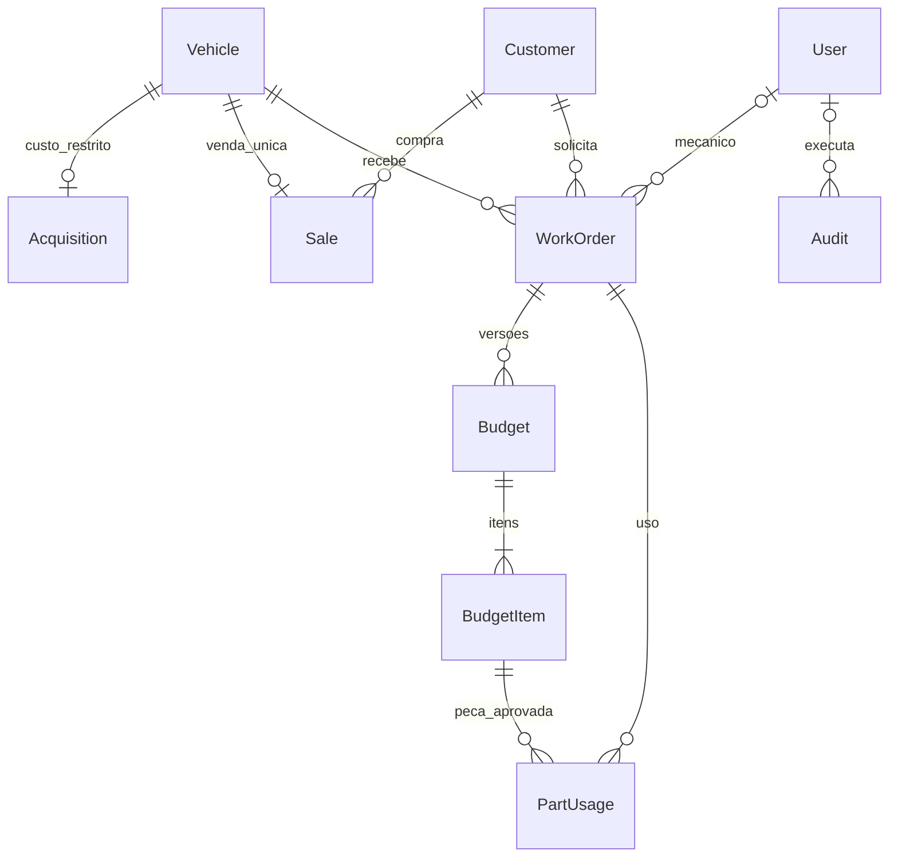

# Arquitetura

## Decisões

Monólito Django 5.2 LTS com templates HTML e CSS próprio. As operações usam formulários HTML e respostas completas do servidor, sem JavaScript, React ou API pública. PostgreSQL 16 é o banco padrão; não há alternativa SQLite. Valores monetários usam Decimal e os formulários aceitam `1234.56` ou `1.234,56`.

Python 3.12 é usado na imagem Docker. O desenvolvimento foi verificado com Python 3.14.3. O framework está fixado em Django 5.2.18. Referências: [Django 5.2 e suporte de Python](https://docs.djangoproject.com/en/5.2/releases/5.2/), [PostgreSQL no Django](https://docs.djangoproject.com/en/5.2/ref/databases/) e [bloqueios de linhas](https://docs.djangoproject.com/en/5.2/ref/models/querysets/#select-for-update).

## Organização

| Caminho | Responsabilidade |
|---|---|
| `config/` | Configuração, conexão PostgreSQL, URLs e WSGI |
| `erp/models.py` e `migrations/` | Modelo relacional e evolução do banco |
| `erp/services.py` | Permissões, transações e regras de negócio |
| `erp/views.py` | Requisições, filtros, páginas e indicadores |
| `erp/forms.py` | Validação de entradas e formatação monetária |
| `erp/admin.py` | Gestão de contas por superusuários |
| `templates/` e `static/` | Interface HTML/CSS, temas e responsividade |
| `erp/tests/` | Testes funcionais, segurança e concorrência |
| `scripts/configurar.py` | Geração local de configuração e segredos |

## Modelo de dados

`Vehicle` identifica uma unidade física. `Acquisition` isola o custo numa relação separada. `Sale` tem restrição única por veículo; o histórico comercial permanece disponível para OS de motos vendidas. `WorkOrder` guarda uma cópia JSON do checklist para preservar seus itens ao longo do atendimento. `Budget` tem versão única por OS, decisão e referências da aprovação. `PartUsage` registra uso, sem movimentar inventário. `Audit` registra autor, ação, entidade e instante, sem copiar custos para logs. A auditoria é operacional, não um registro imutável certificado.

## Integridade e autorização

Todas as operações de negócio da aplicação passam por serviços transacionais. Vendas usam `select_for_update()` sobre a moto, com unicidade adicional no banco. Mudanças da OS bloqueiam sua linha para serializar orçamento, aprovação e execução. Restrição de valores não negativos e coerência entre origem e situação também existem no banco.

O usuário customizado autentica por email e tem papel explícito. A autorização é aplicada na requisição e novamente nos serviços. Custo não entra no contexto HTML dos perfis sem acesso; seu detalhe tem rota administrativa. Requisições de outros perfis tentando inserir campos financeiros restritos são rejeitadas. Mecânicos só acessam OS próprias. O administrador do banco e quem tem acesso ao servidor continuam sendo operadores privilegiados da infraestrutura.

Proteções: CSRF, escape dos templates, logout por POST, sessão HTTP-only, páginas autenticadas sem cache e limite de dez falhas de login por combinação email/IP em quinze minutos, persistido no PostgreSQL. O limite deve ser complementado no proxy em produção. Somente superusuários gerenciam contas no Django Admin.

## Implantação

Compose separa PostgreSQL e aplicação. O servidor WSGI é Gunicorn; WhiteNoise serve os arquivos estáticos coletados. O Compose é configuração local: portas publicadas apenas em loopback e DEBUG habilitado no exemplo. HTTPS, domínio, backups externos, observabilidade e provisionamento de produção precisam ser configurados antes de publicar.
